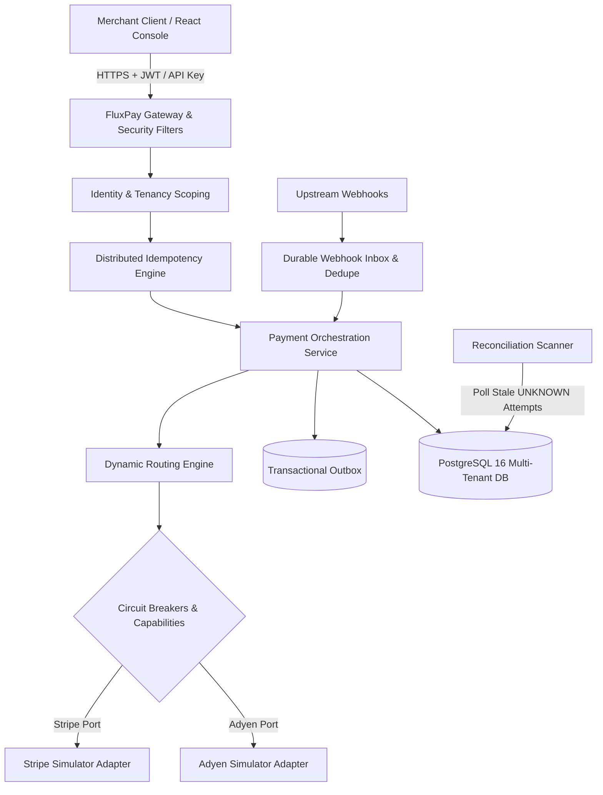

# FluxPay Enterprise Architecture Guide

## 1. System Overview

FluxPay Enterprise is an enterprise-grade multi-tenant payment orchestration platform designed to route, process, reconcile, and audit payments across multiple global payment providers (e.g. Stripe, Razorpay, PayU, Cashfree).

---

## 2. Package Architecture (Modular Monolith)

The codebase is organized in `com.payflow` with strict modular boundaries:

- `common`: Cross-cutting concerns, error codes (`ErrorCode`), standard envelope (`ApiResponse`), `TenantContext`, correlation ID MDC tracing.
- `identity`: User authentication, BCrypt password hashing, SHA-256 hashed API keys (`pf_live_...`), JWT generation, and RBAC filters.
- `merchant`: Merchant profile entity and tenancy repositories.
- `payment`: Core `Payment` and `PaymentAttempt` aggregates, state transition rules, and REST endpoints.
- `provider`: `PaymentProviderPort` interface, capabilities contract, `StripeSimulatorAdapter`, and `AdyenSimulatorAdapter`.
- `routing`: Routing policies, priority and weighted routing algorithms, and circuit breaker exclusion.
- `idempotency`: Canonical request hashing (`SHA-256`), concurrent database unique constraint race handling, response replaying.
- `webhook`: Durable inbox entity (`webhook_events`), signature verification, and deduplication by `(provider_id, provider_event_id)`.
- `refund`: Refund aggregate, refundable balance invariants (`sum <= captured_amount`), and provider refund dispatch.
- `outbox`: Transactional outbox entity (`outbox_events`) and scheduled publisher.
- `reconciliation`: Stale transaction scanner and discrepancy resolution workflow (`reconciliation_cases`).
- `audit`: Append-only audit logger (`audit_logs`) with automatic sensitive field redaction.
- `reporting`: Real-time analytics overview and provider telemetry computed from database aggregations.

---

## 3. Reliability & Fault Tolerance Principles

### 3.1 Idempotency Guarantee (AC-04)
Every mutating payment or refund request requires an `Idempotency-Key` header.
- A canonical string `orderId:amount:currency:method:scenario` is hashed with SHA-256.
- If the key exists with the **identical hash**, the previously cached response is replayed without calling the upstream gateway.
- If the key exists with a **different payload**, HTTP `409 Conflict` is returned immediately.
- Concurrent races on insert are resolved by handling DB unique constraint exceptions and re-reading the committed record.

### 3.2 Gateway Timeout Safety (AC-06 & AC-08)
- If an HTTP timeout or ambiguous error occurs while transmitting to a provider, the payment attempt is recorded as `UNKNOWN` and the payment is marked `PENDING`.
- **Under NO circumstances is the payment marked `FAILED` on an ambiguous timeout.**
- **Under NO circumstances does the engine automatically failover to a second provider.** Doing so would cause double charging if the original gateway captured funds.
- Stale `UNKNOWN`/`PENDING` attempts are picked up by the reconciliation scanner.

### 3.3 Webhook Deduplication (AC-09)
- Webhooks are verified using cryptographic signatures (HMAC-SHA256).
- Every event is recorded in `webhook_events` with a unique constraint on `(provider_id, provider_event_id)`.
- If an event is re-delivered, the inbox recognizes the duplicate, logs the event, and returns HTTP 200 OK immediately without repeating state transitions or emitting redundant outbox messages.

### 3.4 Invariant Refund Invariant (AC-10)
- Refunds are permitted only for payments in `SUCCEEDED` or `PARTIALLY_REFUNDED` states.
- The platform enforces `sum(active_refunds) + requested_amount <= payment.amount_minor`.
- Attempting to refund more than the captured balance returns HTTP `422 Unprocessable Entity` (`REFUND_EXCEEDS_PAYMENT_AMOUNT`).

