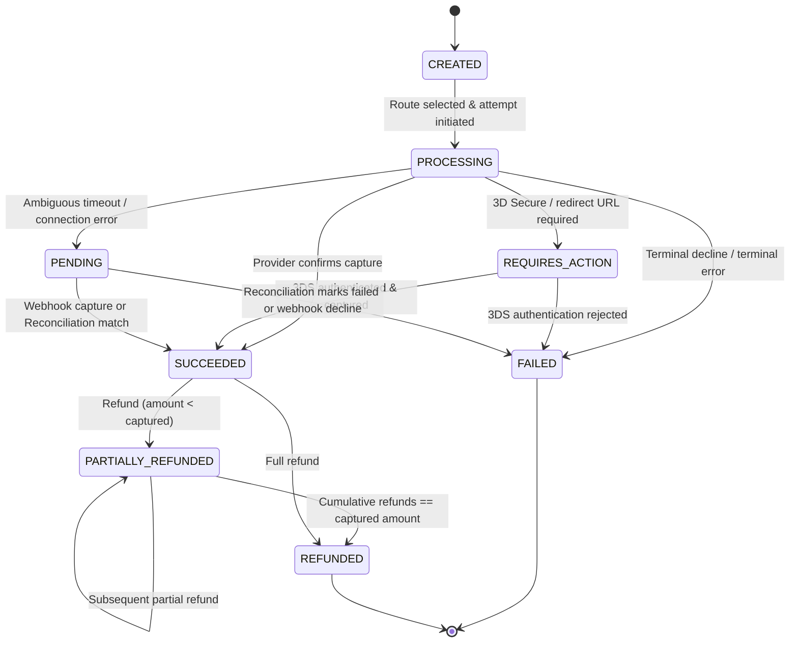

# Payment State Machine & State Transition Matrix

## 1. Payment Lifecycle Aggregate

Payments transition through explicit states with terminal-state regression protection:

---

## 2. Transition Rules Matrix

| Current State | Event / Trigger | Target State | Notes |
|---|---|---|---|
| `CREATED` | Attempt submitted to provider | `PROCESSING` | Optimistic lock incremented |
| `PROCESSING` | Provider returns success | `SUCCEEDED` | Final capture recorded, outbox event emitted |
| `PROCESSING` | Provider returns decline | `FAILED` | Terminal failure, failure code recorded |
| `PROCESSING` | Provider requires 3DS | `REQUIRES_ACTION` | Redirect URL delivered to client |
| `PROCESSING` | Gateway timeout / network error | `PENDING` | **NEVER mark `FAILED`. Attempt recorded as `UNKNOWN`. No blind failover.** |
| `PENDING` | Webhook confirms capture | `SUCCEEDED` | State updated asynchronously via durable inbox |
| `PENDING` | Reconciliation sync confirms failure | `FAILED` | Operator or auto-sync marks failed |
| `SUCCEEDED` | Partial refund processed | `PARTIALLY_REFUNDED` | Balance check `sum(refunds) <= amount_minor` |
| `PARTIALLY_REFUNDED`| Subsequent refund reaches total | `REFUNDED` | Final terminal refund state |
| `SUCCEEDED` | Full refund processed | `REFUNDED` | Final terminal refund state |

---

## 3. Ambiguity & Double-Charge Protection (AC-06 & AC-08)

When external gateway calls exceed the timeout threshold or fail with connection drops:
1. Attempt status is marked `UNKNOWN` with `failure_code: GATEWAY_TIMEOUT`.
2. Payment status is marked `PENDING`.
3. The engine **refuses to trigger an automatic second attempt on another provider**.
4. The transaction enters the **Reconciliation Queue** where the background scanner or webhook will resolve the outcome safely.

